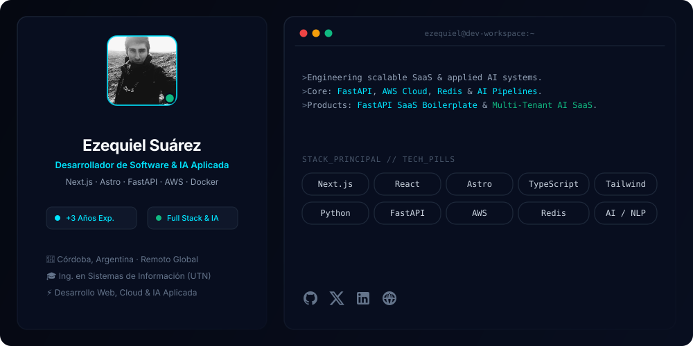

  

  
  
  
  

---

### 👋 Hola, soy Ezequiel Suárez

**Desarrollador de Software & IA Aplicada** con formación en **Ingeniería en Sistemas de Información (UTN)** y más de **3 años de experiencia** construyendo aplicaciones web y productos digitales de punta a punta.

Mi enfoque principal es el desarrollo de software bien estructurado: combino interfaces modernas y rápidas (**Next.js, Astro, React, TypeScript**) con backends escalables y servicios en la nube (**Python, FastAPI, PostgreSQL, Redis, AWS, Docker**), apoyándome en buenas prácticas de diseño de sistemas, principios **SOLID** y arquitecturas limpias (**Clean & Screaming Architecture**). A esta base de ingeniería le sumo formación y práctica en **Inteligencia Artificial Aplicada (Machine Learning, Deep Learning y NLP)** para integrar modelos de IA, automatizar flujos de trabajo y procesar datos dentro de aplicaciones reales.

---

### 🚀 Proyectos Destacados

* ⚡ **[FastAPI SaaS Boilerplate (Enterprise Edition)](https://www.ezequielsuarez-dev.com/)** *(Disponible en Lemon Squeezy)*  
  Núcleo backend *production-ready* para acelerar el lanzamiento de plataformas SaaS B2B escalables.  
  * **Arquitectura & Patrones:** Diseño modular bajo principios *SOLID* y *Screaming Architecture*, con desacoplamiento de servicios e integración de IA en streaming.  
  * **Seguridad & Facturación:** Autenticación dual RS256 con AWS Cognito, control RBAC y suscripciones con webhooks idempotentes en Stripe.  
  * **Asincronía & Calidad:** Procesamiento en segundo plano con Redis (ARQ) y 44 tests automatizados.

* 🎬 **Plataforma SaaS Multi-Tenant de Automatización de Video con IA (Reelify)**  
  Aplicación distribuida para la generación y orquestación automatizada de contenido audiovisual.  
  * **Desarrollo & Arquitectura:** Diseño multi-inquilino con aislamiento de datos, patrones *DDD Light* y procesamiento asincrónico mediante workers.  
  * **IA Aplicada:** Integración de pipelines de NLP para guionado automatizado, segmentación semántica y renderizado en segundo plano.

* 🧠 **Analizador Inteligente de Datos & Documentos**  
  Aplicación modular (**FastAPI + Astro**) enfocada en la extracción estructurada, procesamiento y análisis automatizado de información integrando capacidades de IA/NLP y arquitectura limpia en el backend.

---

### 🛠️ Stack Tecnológico & Fundamentos

| Área | Tecnologías & Herramientas |
|---|---|
| **Frontend & UI** | Next.js · Astro · React · TypeScript · JavaScript · Tailwind CSS · Sass |
| **Backend & APIs** | Python · FastAPI · SQLAlchemy · Alembic · REST APIs · Workers Asíncronos (Redis / ARQ) |
| **Cloud, Datos & DevOps** | AWS (Cognito, SES, S3) · Docker · PostgreSQL · MySQL · Redis · CI/CD (GitHub Actions) |
| **IA Aplicada & Datos** | Integración de LLMs/APIs de IA · Machine Learning · Deep Learning · NLP · PyTorch · Scikit-Learn · Pandas |
| **Ingeniería de Software** | Diseño de Sistemas · Patrones de Diseño · Principios SOLID · Clean & Screaming Architecture |

---

### 💼 Colaboración & Disponibilidad

**🚀 Disponible para proyectos freelance y posiciones remotas globales**  
Enfocado en aportar valor en:
- **Desarrollo Full Stack / Backend** de aplicaciones web y plataformas SaaS de punta a punta.
- **Integración práctica de IA y automatización** en productos nuevos o sistemas existentes con FastAPI y AWS.
- **Interfaces modernas de alto rendimiento** y excelente experiencia de usuario con Next.js y Astro.

  
  

---

### 📊 Actividad en GitHub

  
  

